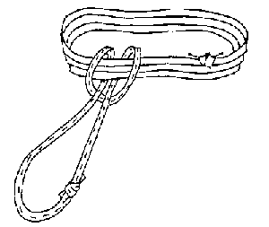
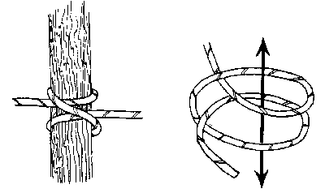
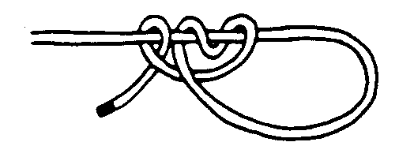
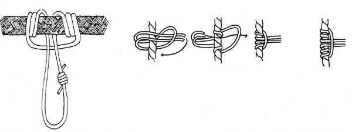
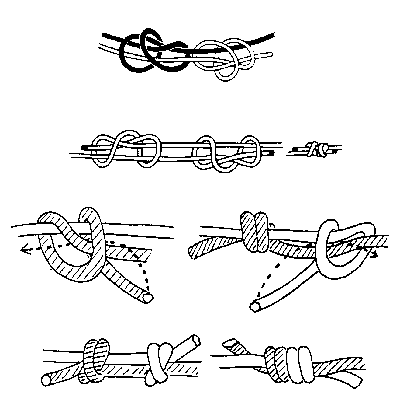
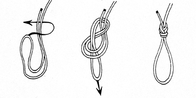
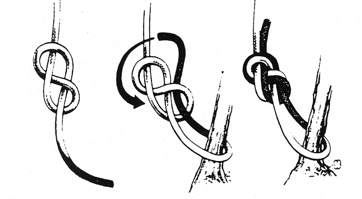
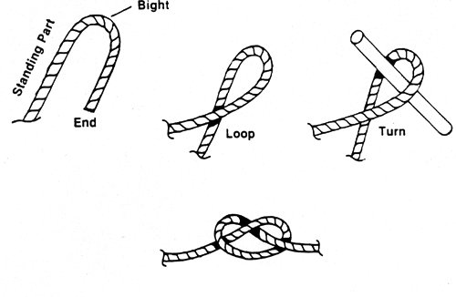
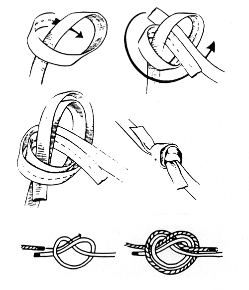

# Appendix G: Knots

# Required Knots
Patrollers are expected to know the knots and hitches listed below. For more instructions, and to view knot-tying animations, visit www.animatedknots.com.

## Girth hitch

## Clove hitch

## Taut line hitch (tent hitch)

## Prusik knot
  * Double Prusik and Triple Prusik

## Double fisherman's knot

## Figure-8 knot on a bight

## Figure-8 knot rewoven

## Overhand knot

## Water knot

Back to the [Patrol Manual](Patrol_Manual.md).
